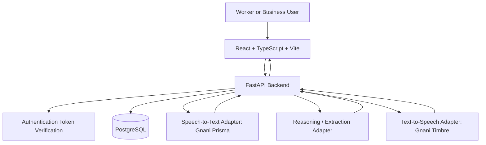

# MehnatLedger — Architecture

**Status:** Proposed architecture v1  
**Rule:** Inspect the actual repository before implementing. If it already contains sound architecture, adapt rather than overwrite it. Any material change must be explained to the product owner.

## 1. System overview

MehnatLedger is a mobile-first web application with separate Business and Worker experiences and an opt-in shared-record workflow.



All provider credentials stay on the server. The frontend must not call Gnani or a reasoning provider directly with a secret key.

## 2. Proposed technology choices

These are defaults, not permission to purchase a service:

- **Frontend:** React, TypeScript, Vite and Tailwind CSS.
- **Backend:** Python, FastAPI, Pydantic and SQLAlchemy.
- **Database:** PostgreSQL, with migrations managed by Alembic.
- **Authentication:** Supabase Auth is a proposed option, not yet confirmed. If selected, the backend must verify JWTs correctly. If an existing repository uses a different secure auth system, inspect it and ask before replacing it.
- **Database hosting:** Supabase PostgreSQL is a proposed option. Production hosting and plan are not yet selected.
- **Speech-to-text:** server-side Gnani Prisma adapter, contingent on access and current official API documentation.
- **Text-to-speech:** server-side Gnani Timbre adapter, contingent on access and current official API documentation.
- **Reasoning/extraction:** a replaceable provider interface. A local/open-weight model through a service such as Ollama can be evaluated for development; do not assume local inference is available in the eventual production host or that another hosted tier is free.
- **Frontend hosting:** Vercel is an option, not a requirement. Backend and database require their own suitable deployment configuration.

The app must remain useful with AI disabled. Do not introduce unrelated services or paid dependencies without approval.

## 3. Backend module boundaries

Suggested module boundaries (adapt to repository conventions):

```text
backend/
  app/
    main.py
    core/          # settings, auth verification, logging, limits
    api/           # versioned HTTP routers
    schemas/       # Pydantic request/response schemas
    models/        # SQLAlchemy entities
    services/      # ledger, work, sharing and balance rules
    repositories/  # data access where useful
    providers/     # Gnani STT/TTS and reasoning adapters
    security/      # ownership and access checks
    tests/
  alembic/
  requirements.txt or pyproject.toml
  .env.example
```

Suggested frontend boundaries:

```text
frontend/
  src/
    app/
    pages/
    components/
    features/business-ledger/
    features/worker-ledger/
    features/shared-hisaab/
    features/voice-entry/
    services/api/
    hooks/
    types/
```

Do not create all directories blindly. Build only what the first phase requires and preserve existing conventions.

## 4. Authentication and authorization

- Every private API endpoint must identify the authenticated user on the server; do not trust a `user_id` supplied in the request body as the caller's identity.
- Verify the configured auth token using the official mechanism. Validate issuer, audience, expiry and signature as appropriate to the chosen provider.
- Every database query that reads or changes a private record must enforce ownership in server code.
- Shared-record access is permitted only when a valid BusinessWorkerLink exists and the requested record is within that link's allowed scope.
- Hiding a frontend button is not authorization. Write tests that call endpoints directly with unauthorized user identities.
- If using Supabase, never expose the service-role key in the frontend. Keep privileged database credentials server-side. Direct browser writes should be disabled unless a reviewed RLS design explicitly permits them.

## 5. Data and transaction rules

- PostgreSQL is the source of truth for confirmed records.
- Store currency using a suitable exact representation, such as integer minor units for a known currency or PostgreSQL `NUMERIC` with validated decimal handling. Do not use floating point for money.
- Keep a separate event/history mechanism for meaningful changes to shared records. Corrections should be traceable; do not silently overwrite the prior state.
- Treat record-approval state separately from payment state if combining them would create ambiguity.
- Use database transactions for updates that must succeed or fail together.
- Use idempotency or duplicate-request protection for voice confirmation and other retryable writes.
- Do not persist a voice draft as a confirmed financial record until the user explicitly confirms it.

## 6. Voice and reasoning pipeline

1. Browser records audio only after an explicit user action and submits it to the authenticated backend.
2. Backend checks authentication, quota, payload size and allowed audio format.
3. `SpeechToTextProvider` sends audio to Gnani Prisma using server-side credentials, if configured.
4. A `ReasoningProvider` extracts candidate fields into a strict schema. It may use a local model or a later approved provider.
5. Pydantic validates field shape and range. Domain services validate allowed state transitions. Python calculates all totals and balances.
6. API returns a **draft** with transcript, parsed fields, warnings and required corrections.
7. User confirms or edits the draft.
8. Backend re-validates ownership and all fields, commits the write transaction and returns the saved record.
9. If requested and enabled, `TextToSpeechProvider` uses Gnani Timbre to read the result aloud.

Never allow the language model to execute arbitrary code or SQL, choose a database user identity, bypass authorization, or make a final financial calculation. Tool calls, if ever added, must be allowlisted and permission-checked.

### Provider interfaces

Define interfaces such as:
- `SpeechToTextProvider.transcribe(audio, language_hint) -> transcript + provider metadata`
- `ReasoningProvider.extract(transcript, schema_name, context) -> candidate fields + confidence/warnings`
- `TextToSpeechProvider.synthesize(text, language, voice) -> audio bytes or streamed audio`

The exact Gnani endpoints, request/response formats, supported languages and quotas must be verified from current official documentation available to the developer. Do not invent them. If access/docs are missing, implement a clearly labelled stub or mock for tests and ask the product owner before claiming live integration.

## 7. API contract outline

Route names are suggestions to be reconciled with existing code; this outline is not a claim that these endpoints already exist.

- `GET /api/v1/me` — current authenticated profile.
- `GET /api/v1/business/entries` / `POST /api/v1/business/entries` — business ledger entries.
- `GET /api/v1/worker/records` / `POST /api/v1/worker/records` — worker's own work/payment records.
- `POST /api/v1/links/invitations` — create a relationship invitation.
- `POST /api/v1/links/invitations/{id}/accept` — accept an invitation.
- `POST /api/v1/shared-records/{id}/acknowledge` — acknowledge a shared record.
- `POST /api/v1/shared-records/{id}/dispute` — dispute a shared record.
- `POST /api/v1/voice/drafts` — create an extracted voice draft.
- `POST /api/v1/voice/drafts/{id}/confirm` — validate and save a draft.
- `POST /api/v1/voice/speech` — synthesize requested speech, subject to quotas.

Use consistent response schemas, pagination where needed, and non-sensitive error messages. Validate every identifier and action against the authenticated user's permissions.

## 8. Secrets and configuration

- Commit `.env.example` with placeholder names only.
- Ignore `.env`, `.env.*` and secret files while explicitly allowing `.env.example`.
- Production credentials belong in the hosting provider's secret/environment manager.
- Never print secrets, authorization headers, full raw audio, or unnecessary sensitive transcripts to logs.
- If a key is exposed, stop using it and instruct the owner to revoke/rotate it.
- Do not use a client-visible environment variable for a private key.

## 9. Reliability, usage and cost controls

- Apply authenticated per-user quotas and rate limiting to all expensive voice operations; add IP-level protection for unauthenticated endpoints.
- Enforce maximum audio duration/file size and content-type validation.
- Keep usage counters and service-health diagnostics, but minimize retained transcript/audio data.
- Return a clear voice-unavailable state and preserve manual form entry when provider calls fail or credits run out.
- Do not silently switch to a paid provider, enable billing, or send private data to an unapproved model.
- Use timeouts, bounded retries and idempotency; avoid retry loops that burn credits.

## 10. Observability and testing

Test:
- money arithmetic and rounding;
- ownership and cross-user access;
- invitation acceptance and unlinking;
- proposed/acknowledged/disputed/settled transitions;
- voice-draft confirmation and duplicate submission;
- absent/invalid API key, quota exhaustion, provider timeout and malformed provider output;
- data migrations and a clean test database.

Log request IDs, timing, status and provider error categories where safe. Never log provider secrets.

## 11. Deployment boundary

GitHub stores source code, migrations, test fixtures and `.env.example`, not runtime secrets. Production users access the deployed frontend; it calls the deployed backend over HTTPS. The backend uses server-side credentials for database and AI provider access. Downloading the source repository must not grant access to the owner's API account or database.

Before a live deployment, verify CORS origins, HTTPS, authentication configuration, database migrations/backups, secret configuration, rate limits, provider spending/quota controls and privacy notice.
